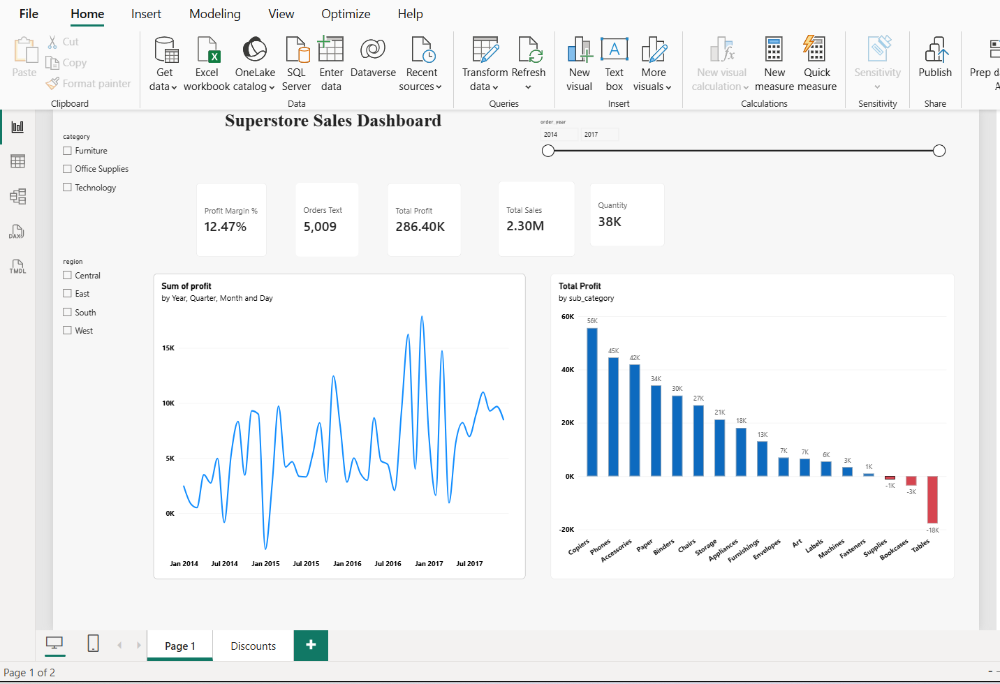
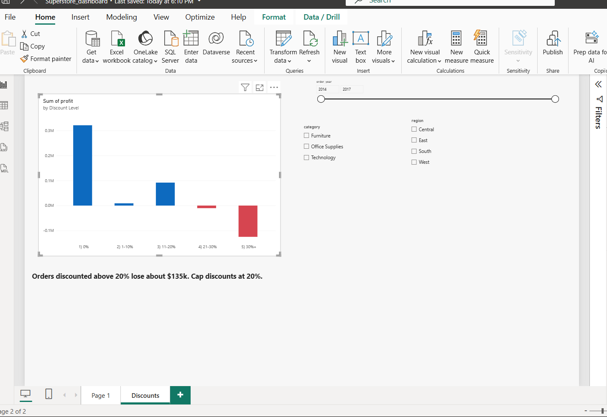

# Superstore Sales Analysis:

## Why Is Profit Low?
End-to-end data analytics project using SQL (SQLite),
Python (pandas, matplotlib), and Power BI on the
Superstore retail dataset (9,994 order lines, 2014-
2017).

## Business Question
Which products and discount levels are hurting profit,
and what should the business change?

## Key Results
Metric       Value
Total sales  $2,297,201
Total profit  $286,397
Profit margin  12.47%
Orders         5,009

## Key Findings
1. Discounts above 20% destroy profit. 1,393 order
lines (about 14%) lose $135,376 combined.
Average profit per line is -$45.68 at 21-30%
discount and -$107.21 at 30%+.
2. Three sub-categories lose money: Tables
(-$17,725), Bookcases (-$3,473), Supplies
(-$1,189).
3. The losses come from heavy discounting, not the
products themselves. Tables, Machines, and
Binders lose $30.7k, $29.6k, and $38.5k on orders
discounted above 20%.
4. Sales grew 51% (2014 to 2017), but margin fell in
2017 (13.43% to 12.74%). Furniture margin
dropped from 3.5% to 1.4%. Binders margin
halved (20.6% to 10.5%) and the Tables loss
tripled.
5. Sales peak in Sep, Nov, Dec (43% of sales), but
monthly profit stays flat.

## Hypotheses Tested and Rejected
"Higher average discounts caused the 2017 margin
drop." Rejected: average discount stayed near
15.5% every year.
"Peak months run heavier discounts." Rejected:
average discount is about 15% in all months.

## Recommendations
1. Cap discounts at 20%. Potential upside of up to
about $135k (some of those sales may not
happen without the discount).
2. Review Tables pricing and supplier costs. Its loss
tripled in 2017 although discounts did not change.
3. Audit Binders discounting. It grew 47% in 2017
while its margin halved.
4. Plan inventory and staffing for Sep to Dec.
## Tools and Workflow
1. Python (pandas): cleaned data, fixed data types,
created profit_margin , shipping_days ,
order_month , discount_band .
2. SQL (SQLite): KPI queries, group-bys, window
functions, CASE WHEN discount bands.
3. matplotlib: exploratory charts.
4. Power BI: 2-page interactive dashboard (overview
and discounts) with slicers.

## Project Structure
data/ raw and cleaned CSV
sql/ 02_queries.sql
notebooks/ Superstore_Dataset.ipynb
dashboard/ superstore_dashboard.pbix
images/ charts and dashboard
screenshots

## Dashboard Preview

## Limitations
The dataset has no cost column, so the cause of
Tables' growing loss cannot be confirmed.
Calendar-month results combine four years, so
single products can distort a month.
Discount impact assumes the same sales volume
without the discount, which may not hold.
Data Source
Sample Superstore dataset (Tableau sample data,
public domain)
